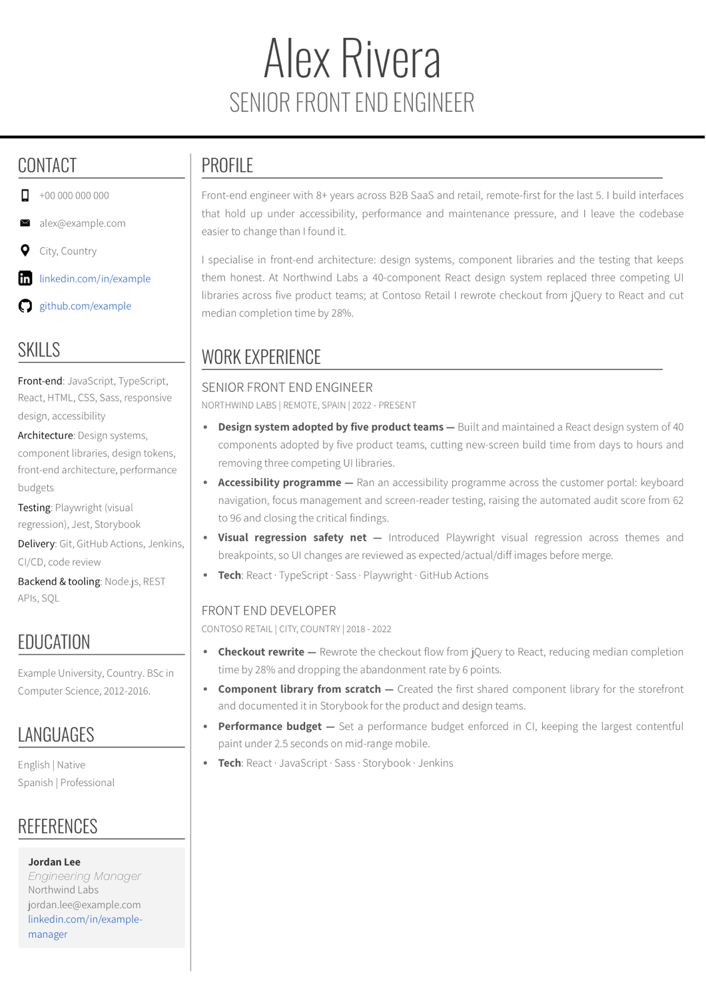

# evidence-cv

**A CV pipeline where every line is traceable to an evidence database.**

<p align="center">
  
</p>

Most CVs drift. You tailor one for a job, soften a claim, add a technology you "kind of" used, and six months later you cannot remember which version said what. This repo reverses that: the CV is a **projection** of a database of claims you can defend in an interview, and a rule — *nothing goes on the CV that the database cannot back* — is enforced at every step.

It also closes the other loop most job searches leave open: every requirement you cannot meet is logged as a **gap**, so rejections turn into a learning list instead of noise.

## Why I built this

I was writing the same CV for the fifteenth time, and each version was slightly more confident than the last. A tool I had touched once became "experience with". A project where I owned the front end became "led the project". None of it was a lie exactly, but none of it was evidence either — and I could feel the difference in interviews, where the follow-up question decides whether a bullet was real.

What I actually needed was not a better template. It was a way to make the honest answer the easy one: write down what I did once, with numbers, and let every CV be a selection from that list. Hence rule zero, hence the weights, hence the gap log. The CVs got shorter. The interviews got easier.

If you are the kind of person who keeps a brag document, this is that document with a build step.

---

## The idea in one diagram

```
experience.yaml          criteria.yaml
(what you can prove)     (what is worth applying to)
        │                        │
        └────────┬───────────────┘
                 ▼
        assess the posting  ──►  hard filters + score + gaps
                 ▼
        choose a positioning (2-3 proposed, you approve one)
                 ▼
        cv-content.json  ──►  cv-template.html  ──►  cv.pdf
                 ▼
        history.json + gap-log.md   (what happened, what is missing)
```

The database is the only source of facts. The template, the scoring, and the prose are all replaceable; the evidence is not.

---

## Why a database and not a document

A CV in a text editor has no memory. It cannot tell you:

- which of your claims are **lead** achievements and which are supporting detail;
- which technologies you have **shipped** versus merely **touched**;
- which requirements you keep failing across applications;
- what you told which company, and when.

`experience.yaml` answers all four. Each claim has an `id`, a `weight` (`lead`, `support`, `interview`), the skills it exercises, and its metrics. Each skill has a `level`:

| Level | Meaning | On a CV |
|---|---|---|
| `shipped` | in production, defensible under questioning | yes |
| `working` | used, not expert — word it modestly | yes, carefully |
| `conceptual` | understood, no production use | no — it is a gap |
| `none` | not yours | never |

A claim marked `weight: interview` never reaches the page. A skill marked `conceptual` or `none` never becomes a bullet. `do_not_claim` is a hard stop for the things you are tempted to oversell.

That constraint is the whole point: a shorter CV that survives scrutiny beats a longer one that collapses in the first technical conversation.

---

## What is in the repo

| Path | Purpose |
|---|---|
| `examples/experience.yaml` | The evidence database: claims, weights, skill levels, `do_not_claim` |
| `examples/criteria.yaml` | Hard filters (location, contract, clearance, salary) and the 0-100 scoring model |
| `examples/cv-content.json` | The CV as structured data — the only input the renderer reads |
| `examples/phrase-bank.yaml` | Vocabulary harvested from postings. **Words only, never facts.** |
| `examples/sample-posting.md` | A fictional posting to try the workflow on |
| `examples/sample-cv.pdf` | The example CV built from the example data — one page, real output |
| `docs/sample-cv.png` | Its first page, as shown above |
| `template/cv-template.html` | A4 print template, two columns, fonts and icons included |
| `scripts/build_pdf.py` | Template + JSON → PDF via headless Chrome (stdlib only) |
| `scripts/writeback.py` | Appends an application to `history.json` and its gaps to `gap-log.md` |
| `scripts/verify_pdf.py` | Checks a built PDF: required strings present, forbidden strings absent, page count |
| `scripts/init.py` | Copies the examples into `data/` and fills in your identity |
| `AGENTS.md` | Portable instructions for a coding agent (rule zero, workflow, write-back rules) |
| `.opencode/skills/tailor-cv/` | The same workflow packaged as an OpenCode skill |

Your real data lives in `data/` and is **git-ignored**. Only the examples are committed, so the repo is safe to publish.

---

## Quickstart

Requirements: Python 3.10+ and Chrome, Chromium or Edge. No Python packages are needed to build a PDF. `examples/sample-cv.pdf` is what the toolchain produces from the example data.

```bash
git clone <this repo> && cd evidence-cv

python3 scripts/init.py --name "Your Name" --email you@example.com \
  --phone "+34 600 000 000" --location "City, Country" \
  --linkedin "linkedin.com/in/you"

# 1. Replace the example claims in data/experience.yaml with your own.
# 2. Edit data/criteria.yaml: what counts as a job worth applying to.
# 3. Build the example CV to check the toolchain:
python3 scripts/build_pdf.py --content data/cv-content.json --out output/cv.pdf

# 4. Check the result against a spec:
python3 scripts/verify_pdf.py --pdf output/cv.pdf --spec data/verify.json

# 5. After an application, record it:
python3 scripts/writeback.py --file output/writeback.json
```

`make init`, `make pdf`, `make verify` and `make log` wrap the same commands.

### Working with an agent

The workflow is written for a coding agent that can read your files and build the PDF:

1. It reads the posting, `experience.yaml` and `criteria.yaml`.
2. It applies the hard filters and scores the role, showing its reasoning.
3. It maps every requirement to a `shipped` / `working` / `conceptual` / `none` level with claim IDs.
4. It proposes two or three positionings, each bullet traced to a claim ID.
5. **It stops.** Nothing is built until you approve.
6. It builds the PDF, verifies it, and writes back the history entry and gaps.

In OpenCode the skill is already installed at `.opencode/skills/tailor-cv/`; other agents can read `AGENTS.md`.

---

## Design decisions

- **YAML for the database, JSON for the CV.** YAML because claims are long prose and comments matter; JSON because the renderer should not guess.
- **HTML → Chrome instead of a PDF library.** Full control of print CSS (page breaks, orphans, flex columns) with zero dependencies, and the template stays editable by anyone who knows CSS.
- **Scoring is explicit, not vibes.** Fixed weights, published thresholds, and penalties for required skills you do not have. You can disagree with the model — it is a file you can edit.
- **Gaps are a feature.** Every application records what it exposed. After twenty applications the gap log is a study plan ranked by demand.
- **One application, one folder.** `output/<date>-<company>-<role>/` holds the content, the PDF, the trace and the write-back payload, so you can reconstruct any CV you ever sent.

---

## Non-goals

- It does not apply for you, and it never submits anything.
- It does not invent achievements, metrics or technologies. If the database is thin, the CV is thin — that is the point.
- It is not a résumé *builder*: there is no form, no wizard, no cloud account. It is a repository you version.

---

## Contributing

Issues and pull requests are welcome — see [`CONTRIBUTING.md`](CONTRIBUTING.md) for the details. The short version: engine, template and docs yes; real personal data never; and the core scripts stay standard-library only.

## Licence

MIT for the code. The bundled fonts (Assistant, Oswald, Work Sans) are under the SIL Open Font License 1.1 — see `template/fonts/OFL.txt`.
